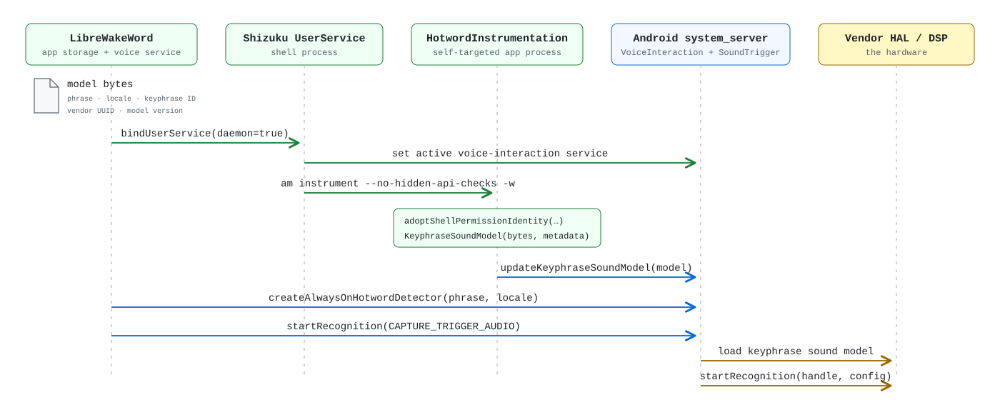

   
# LibreWakeWord

Real, hardware-based custom wake word support for Android (including the original reverse-engineered "Hey Google" pipeline). Supports GrapheneOS and other de-Googled OSes! Currently POC and alpha. Powered by Shizuku.

Super dank diagram thing to show how cool it is thanks codex:

## 🫪 what is this bro

LibreWakeWord basically hacks your own phone to load (custom) wake-word models into your phone's DSP, the hardware component designed for this wake word stuff (that's what "Hey Google" uses on stock OSes). Now you can use (custom) wake words to trigger another assistant (e.g. Dicio) / activity / interaction / webhook / whatever on any Android OS, including GrapheneOS! It acts as a helper app, separate from the app/thing that actually wants to be triggered.

This avoids having to keep a persistent mic session open and doing the actual detection on CPU, which completely nukes your battery, disrupts other apps that want microphone, and leaves you with that annoying green microphone indicator in the top right all the time.

I originally developed this on a pixel phone with grapheneos, so i was testing with an extracted version of the actual "Hey Google" DSP model (cause I know it works). Thus I also (re)implemented the full "Hey Google" cascade, including the second stage model that classifies if the sensitive DSP model was right, and also voice match (which works-ish). In the future I plan to support a full non-proprietary stack using models like microWakeWord since they conveniently fit what at least my pixel DSP can run (kinda).

It uses Shizuku to do all the hacker impersonation and permission stuff required to pull off the DSP model loading. Shizuku is a helper app that keeps a persistent ADB session open that other apps (like LWW) can use. Of course this isn't a fun security perk (especially since the target demographic for something like this is those running alternative (security focused) Android OSes), but I mean there's no way to do it unprivileged and I know there's at least one person willing to accept the compromise of using Shizuku in order to gain this functionality (me).

also LWW doesn't need to be your default assistant, so your actual assistant app can have that. it does take over the voice interaction service setting though, cause that's the only way android lets anything load a keyphrase model into the DSP. there's no way around that one, see [architecture](docs/architecture.md#arming) if you care about why.

The app is currently a POC and will change a lot so I wouldn't integrate it with your own app or actually use it yet. I also didn't write a single line of code yet, or anything for that matter apart from this readme, so you can take up all the stupid shit you find the code doing with sam altman.

## ☑️ Requirements

- Android 13 or newer.
- Hardware and a vendor sound-trigger HAL capable of enrolling a DSP keyphrase model.
- [Shizuku](https://github.com/thedjchi/Shizuku)
- Pixel phone maybe? idk i haven't tried with other stuff
- your assistant app can't be a voice interaction service itself, since android only allows one and LWW needs it (dicio and most FOSS ones are fine)
- A DSP keyphrase model and matching phrase, locale, keyphrase ID, vendor UUID, and model version.
- A compatible second-stage verifier model and runtime.

so yeah for the last two things, i have to gitignore the actual hey google stuff for now, so you can't really use this unless you extract that yourself (legally please, so not from the online factory image download thing by Google) so have fun with that if you want to use this. again currently this is a shitty POC.

## 🤩 Roadmap/TODO

i have a lot of things I want to do before this is sort of usable:
- add microWakeWord support (probably works with at least pixel DSPs) and separate the proprietary hey google pipeline from the normal libre pipeline
- fix dogshit hey google voice match reimplementation (barely works)
- validate the hey google stage 2 verifier ("SODA") to make sure it's tuned properly since i think it relies on some network config i have to reverse engineer
- make the whole automatic proprietary hey google DSP and soda extraction tooling (and i think reimplement some soda stuff so we don't rely on proprietary stuff there unless needed)
- make the app not buggy and shit and fix really terrible codex slop UX
- fix the weirdo "arming" UX and also the weirdo terminology everywhere exposed to the user, AI likes doing that
- unsloppify the code and all the stupid unnecessary workarounds that workaround nothing (in progress)

## 🤯 Consumer API

so yeah there's a consumer api where apps can become consumers and like get stuff like triggered on DSP trigger (sensitive, many false positives) or after the second layer confirmation, and it has this like super complex mic handoff system so that LWW doesn't have to own the microphone and your app can just use it normally. docs are in [docs/api.md](docs/api.md) and there's a [`sample-consumer`](sample-consumer) app that shows off everything.

Not yet hosted in a public Maven repository.

## 🥹 License

LibreWakeWord is licensed under the [GNU Affero General Public License v3.0 or later](LICENSE).

## 😻 Current hardware scope

i developed and tested this on pixel hardware with grapheneos, that's the primary target anyway. once this whole project isn't sloppy shit i'll work on hardware support and all that fun stuff.
